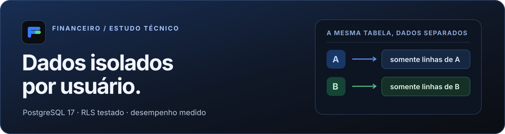
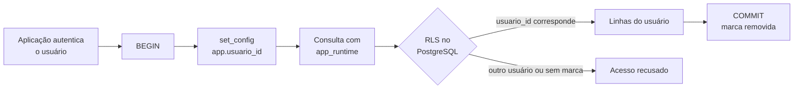

<p align="center">
  
</p>

# Financeiro RLS

**Isolamento por usuário no PostgreSQL 17, verificado com o papel real da aplicação.** Este repositório reúne as migrações, 10 testes de segurança e um estudo de desempenho de três consultas financeiras. O material foi extraído de um app real e usa apenas dados sintéticos.

**Explore:** [rodar os testes](#rodar-os-testes) · [entender a proteção](#como-o-isolamento-funciona) · [ver os resultados](#resultados-medidos) · [ler o relatório completo](docs/relatorio.md)

| O que há aqui | Evidência |
| --- | --- |
| **Isolamento** | 10 testes contra um PostgreSQL real, executados como `app_runtime` |
| **Carga medida** | 1.393.270 lançamentos fictícios de 200 usuários |
| **Decisão de desempenho** | Um índice adotado; uma reescrita de política descartada após a medição |

## Como o isolamento funciona



O app marca o usuário **dentro da transação** com `set_config('app.usuario_id', id, true)`. A política `dados_do_usuario` compara essa marca com `usuario_id` em cada linha. O `true` limita a marca à transação; ela não acompanha uma conexão reutilizada pelo pool.

As chaves estrangeiras compostas `(usuario_id, x_id)` impedem referências a dados de outra pessoa. Isso é necessário porque a checagem de chave estrangeira não respeita o RLS da mesma forma que uma consulta comum. Sem usuário marcado, a função `app_usuario_atual()` gera o erro `app_usuario_ausente`.

> **Limite da proteção:** a marca é definida pela aplicação; o banco não autentica a pessoa. Quem obtiver o papel `app_runtime` e puder executar SQL arbitrário pode marcar outro usuário. O RLS protege consultas que esquecem o filtro de usuário, mas não substitui autenticação nem consultas parametrizadas. Leia a [decisão de arquitetura](docs/adr-0025-rls-por-usuario.md).

## Rodar os testes

Requisitos: **Docker com Compose** e **Node 24**. O banco de teste roda em `127.0.0.1:55433`, separado dos outros projetos.

```bash
cp .env.example .env          # ajuste as senhas; .env não entra no Git
docker compose up -d --wait
npm ci
npm run migrar                # papéis, banco de teste e três migrações
npm test
```

Resultado esperado: **10 testes passando**. O teste usa dois usuários, A e B, e verifica leitura, escrita, exclusão, referências entre tabelas, privilégios do papel e limpeza do contexto ao fim da transação. Para encerrar, rode `docker compose down`; o volume permanece para a próxima execução.

<details>
<summary><strong>O que cada teste verifica</strong></summary>

| Verificação | Por que importa |
| --- | --- |
| `app_runtime` não é superusuário, dono das tabelas nem tem `BYPASSRLS` | A política realmente se aplica ao papel usado no teste |
| Toda tabela com `usuario_id` tem RLS e `dados_do_usuario` | Uma tabela nova sem política faz o teste falhar |
| O papel não cria nem esvazia tabelas ou altera migrações | Privilégios mínimos |
| A lê apenas as próprias linhas | Leitura isolada, inclusive por identificador |
| A não altera nem apaga linhas de B | `USING` em `UPDATE` e `DELETE` |
| A não grava linhas como B nem transfere uma linha para B | `WITH CHECK` |
| A não cria uma referência para uma linha de B | Chaves estrangeiras compostas |
| Sem marca, ler ou escrever gera erro | Falha fechada |
| A marca some depois da transação | Sem vazamento entre usos da conexão |
| A marca, sozinha, não comprova identidade | O limite do RLS fica explícito |

Para testar a força da suíte, dar `BYPASSRLS` ao papel faz **7 dos 10 testes falharem**. O teste de chave estrangeira continua passando porque independe do RLS. O código central está em [`tests/isolamento.test.ts`](tests/isolamento.test.ts).

</details>

## Resultados medidos

O estudo comparou três consultas em dados sintéticos. Os números abaixo são **medianas do `Execution Time` do `EXPLAIN ANALYZE`** para o usuário com 120 mil lançamentos, neste ambiente. Veja o [método e os limites](docs/relatorio.md) antes de extrapolar os valores.

| Consulta e mudança | Antes | Depois | Decisão |
| --- | ---: | ---: | --- |
| **Q3 · último meio de gasto** com índice parcial | 325–335 ms; 116.283 linhas lidas | 0,09–0,10 ms; 1 linha | **Adotado** em [`migrations/03_ultimo_meio_de_gasto.sql`](migrations/03_ultimo_meio_de_gasto.sql) |
| **Q2 · faturas** com política reescrita em `initPlan` | ~8 ms | 74–87 ms | **Descartado**: o plano piorou para o usuário pesado |
| **Q1 · lançamentos do mês** | 6–7 ms no usuário pesado | Sem mudança relevante | O índice existente atende esta consulta |

O isolamento continuou válido no banco carregado: **49 de 49 conferências** passaram antes e depois das mudanças. O estudo também publica a comparação sem RLS, medições com `pgbench` e os [planos de execução](resultados/planos/). O [resumo das 108 séries](resultados/resumo.txt) está disponível para auditoria.

<details>
<summary><strong>Ambiente e reprodução do estudo</strong></summary>

O estudo usou PostgreSQL **17.11** em Docker Desktop/WSL2 no Windows 11, com 200 usuários e 1.393.270 lançamentos gerados com semente fixa. Cada série teve um aquecimento e 30 medições; o roteiro completo foi executado duas vezes. O cache do sistema operacional estava quente. Não foram medidos cache frio, concorrência ou escritas. O `EXPLAIN ANALYZE` não inclui a rede nem o envio das linhas ao cliente.

Com o Docker ligado e `npm run migrar` concluído, os comandos abaixo reproduzem a carga e as medições em um banco separado. Requerem Bash:

```bash
bash estudo/01_preparar.sh      # carga sintética; cerca de 4 minutos
bash estudo/00_rodar_tudo.sh    # duas rodadas e conferência do isolamento
node estudo/08_resumir.mjs
npm run estudo:apagar           # apaga somente o banco do estudo
```

Para uma conferência rápida dos scripts: `RODADAS=1 MEDICOES=5 bash estudo/00_rodar_tudo.sh`. As saídas locais ficam em `estudo/saidas/`, fora do Git; os resultados publicados ficam em [`resultados/`](resultados/).

</details>

## Arquivos principais

| Caminho | Conteúdo |
| --- | --- |
| [`migrations/`](migrations/) | Esquema, RLS e índice adotado |
| [`papeis/papeis.sql`](papeis/papeis.sql) | Papéis `app_migrador` e `app_runtime` |
| [`tests/isolamento.test.ts`](tests/isolamento.test.ts) | Testes de isolamento no PostgreSQL real |
| [`estudo/`](estudo/) | Carga, consultas, cenários e medições |
| [`docs/relatorio.md`](docs/relatorio.md) | Método, números completos e limitações |
| [`docs/adr-0025-rls-por-usuario.md`](docs/adr-0025-rls-por-usuario.md) | Decisão de arquitetura |

## Licença

MIT. Consulte [LICENSE](LICENSE).
